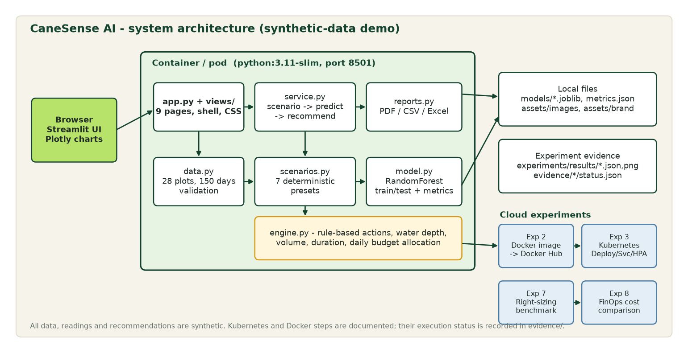

# CaneSense AI — Architecture

Academic mini-project by **Raj Tripathi** (Roll 16014223062, Batch B1 AIDS), submitted to Prof. **Sagar Korde** for the Cloud Computing assignment
*Cloud Computing Experiments through Somaiya Vidyavihar AI Use Cases* — use case **KJS-AGR-01**.

Editable source: [architecture.mmd](architecture.mmd) (Mermaid). The PNG is rendered by `scripts/make_assets.py`.

## Layers

| Layer | Files | Responsibility |
|---|---|---|
| Presentation | `app.py`, `views/*.py`, `canesense/theme.py`, `ui.py`, `panels.py`, `charts.py` | Navigation shell, design system (CSS tokens), pages, Plotly figures |
| State | `canesense/state.py` | Streamlit session state: active scenario, history, simulated actions, selected plot. Cached computations are pure functions of `(scenario, overrides)` |
| Pipeline | `canesense/service.py` | `baseline → scenarios.apply → model.predict → engine.recommend` |
| Domain | `data.py`, `scenarios.py`, `model.py`, `engine.py` | Synthetic dataset + validation, deterministic presets, RandomForest classifier, rule engine |
| Output | `reports.py` | PDF (ReportLab), CSV, Excel (XlsxWriter) from the selected records |
| Experiments | `scripts/benchmark.py`, `scripts/finops.py`, `Dockerfile`, `k8s/` | Cloud experiments 2, 3, 7, 8 |

## Data flow (one rerun)

1. The user opens a page; `state.frame()` calls the cached `service.scenario_frame(scenario, overrides)`.
2. The baseline snapshot (28 plots) is transformed by the scenario preset (pure, deterministic).
3. The RandomForest predicts `P(Low/Medium/High)` per plot (missing sensor values imputed from the village median and flagged).
4. The rule engine chooses the action, water depth/volume/duration and allocates the daily water budget by priority.
5. Views render KPIs, charts, the map and tables from that one frame, so all pages agree.

## Deployment view

- One stateless container (`python:3.11-slim`, non-root UID 10001, port 8501, health endpoint `/_stcore/health`).
- The model is trained inside the image at build time so the pickle always matches the installed scikit-learn.
- Kubernetes: Deployment (2 replicas, rolling update, readiness/liveness probes, requests 250m/512Mi, limits 1 CPU/1Gi), ClusterIP Service (80→8501), optional HPA (CPU 70%).
- Assets use the same relative structure locally and in the image (`assets/images`, `assets/brand`, `models`, `experiments/results`).

## Design decisions

- **Streamlit retained** (no separate frontend) with a custom CSS design system and `st.navigation` for real per-page URLs that share session state.
- **Offline-first**: charts, the field-zone map and reports need no internet. Street tiles are an opt-in toggle.
- **Honest status**: the health chip is computed from real checks; Cloud Lab reads `evidence/*/status.json` rather than claiming success.
- **Deterministic demos**: scenarios are fixed transformations of a seeded dataset.
