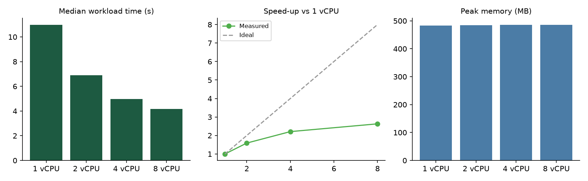

# Experiment 7 — Cloud Resource Right-Sizing

Student: Raj Tripathi · Roll 16014223062 · Batch B1 AIDS · Prof. Sagar Korde · Use case KJS-AGR-01

## Verification status

**Executed** on the author's machine (results, chart and console log saved). The CPU profiles are an *emulation* on one host, not cloud instances — see Limitations.

## Workload

The real CaneSense analytics pipeline (`scripts/benchmark.py`): simulate 6 synthetic estates (25,200 plot-day rows) → feature engineering and labelling → train a 300-tree RandomForest → batch inference on all rows → 20 runs of the recommendation engine. Seed fixed; every profile does identical work (macro-F1 0.903 in every run).

## Method

- One fresh subprocess per repetition, pinned to N logical CPUs with OS affinity (`psutil.cpu_affinity`) and `OMP/OPENBLAS/MKL_NUM_THREADS=N`; the model's `n_jobs=N`.
- Profiles: 1, 2, 4, 8 CPUs; 3 repetitions each; median reported. Metrics: workload time, per-stage time, peak working-set memory.
- Memory scaling: the workload at 1×, 3×, 6× data volume (2 CPUs).
- Host: Windows 10 build, Intel64 Family 6 Model 197, 16 logical CPUs, 31 GiB RAM, Python 3.11.0.

Reproduce: `python scripts/benchmark.py --cores 1,2,4,8 --reps 3 --scale 6`

## Results (`experiments/results/rightsizing.json|csv|png`)

| Profile | Median time (s) | Min–max (s) | Speed-up | Efficiency | Peak memory (MB) |
|---|---|---|---|---|---|
| 1 vCPU | 10.98 | 10.84–11.41 | 1.00× | 100% | 483 |
| 2 vCPU | 6.89 | 6.86–6.97 | 1.59× | 80% | 485 |
| 4 vCPU | 4.97 | 4.82–4.98 | 2.21× | 55% | 486 |
| 8 vCPU | 4.18 | 4.09–4.18 | 2.63× | 33% | 486 |

Stage medians (1 vCPU → 8 vCPU): training 9.44 s → 2.55 s; simulation ~0.9 → 1.1 s (single-threaded, does not scale); inference 0.30 → 0.12 s.

Memory vs data volume: 4,200 rows → 226 MB; 12,600 rows → 334 MB; 25,200 rows → 484 MB (roughly +12 MB per 1,000 rows over a ~175 MB base).

## Findings

1. Only the training stage parallelises; the single-threaded simulation (Amdahl's law) caps the speed-up at 2.6× for 8× the CPUs. Efficiency drops from 80% (2 vCPU) to 33% (8 vCPU).
2. Memory is independent of CPU count and grows with data volume, so memory — not CPU — sets the *minimum* size: ~0.5 GB peak for this workload, meaning ≥ 1 GiB instances with headroom.
3. **Recommendation:** 2 vCPU / ≥ 1–2 GiB is the best balance (80% efficiency, 63% of the single-CPU time). Going to 4 vCPU saves a further 1.9 s at +100% CPU cost; 8 vCPU is poor value.
4. For the interactive Streamlit app (not the batch workload) the Kubernetes requests of 250m CPU / 512Mi are a starting point to be validated under real load.

## Limitations

- CPU affinity on one machine does not model a hypervisor, burst credits, noisy neighbours, or a different CPU. Treat results as relative scaling evidence.
- Memory was **measured, not limited**; no out-of-memory behaviour was tested.
- Not executed: the container variant with enforced limits, `scripts/docker_benchmark.ps1` (Docker unavailable).
