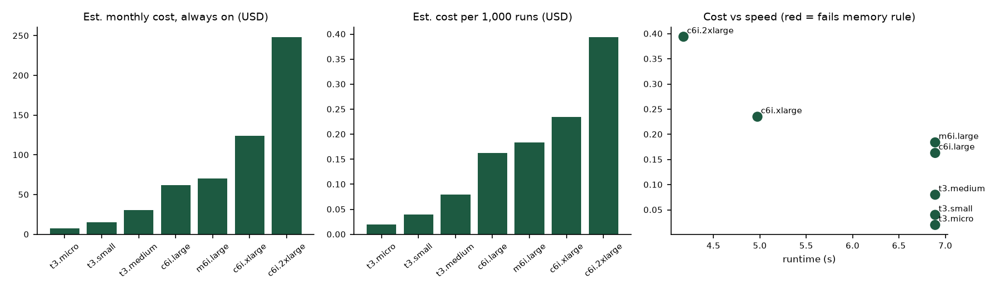

# Experiment 8 — FinOps and Instance-Type Comparison

Student: Raj Tripathi · Roll 16014223062 · Batch B1 AIDS · Prof. Sagar Korde · Use case KJS-AGR-01

## Verification status

**Executed** (calculation). Every cost figure is an **estimate** derived from assumed list prices; **no cloud account was used and no actual charges exist.**

## Method

`scripts/finops.py` reads the Experiment 7 measurements (same workload, same conditions) and maps each instance to the measured runtime for the matching vCPU count.

- Prices: assumed public on-demand list prices (USD/hour, Linux, a US region), typed into the script. They were **not** fetched from a billing API — verify with the provider's pricing calculator before relying on them.
- Always-on monthly cost = hourly × 730 h.
- Workload cost per run = hourly × runtime ÷ 3600; cost per 1,000 runs; monthly workload-based cost = per-run cost × 24 runs/day × 30 days (idealised per-second billing).
- Memory rule: measured peak (486 MB) × 1.5 headroom ≤ 85% of instance memory.
- Excluded: storage, network, support, taxes, burst-credit throttling on `t3` instances.

Reproduce: `python scripts/finops.py` (after the benchmark).

## Results (`experiments/results/finops.json|csv|png`)

| Instance | vCPU | GiB | Assumed $/h | Runtime (s) | Always-on $/month | $ per 1,000 runs | Fits memory |
|---|---|---|---|---|---|---|---|
| t3.micro | 2 | 1 | 0.0104 | 6.89 | 7.59 | 0.020 | yes (tight) |
| t3.small | 2 | 2 | 0.0208 | 6.89 | 15.18 | 0.040 | yes |
| t3.medium | 2 | 4 | 0.0416 | 6.89 | 30.37 | 0.080 | yes |
| c6i.large | 2 | 4 | 0.0850 | 6.89 | 62.05 | 0.163 | yes |
| m6i.large | 2 | 8 | 0.0960 | 6.89 | 70.08 | 0.184 | yes |
| c6i.xlarge | 4 | 8 | 0.1700 | 4.97 | 124.10 | 0.235 | yes |
| c6i.2xlarge | 8 | 16 | 0.3400 | 4.18 | 248.20 | 0.394 | yes |

## Findings

- Cheapest per run that fits memory: **t3.micro** (~$0.020 per 1,000 runs, estimated) — but 1 GiB leaves little headroom beyond the 486 MB peak, and burstable CPUs may throttle under sustained load, which the model ignores. **t3.small** is the safer low-cost choice.
- Fastest: **c6i.2xlarge** (4.18 s) at ~20× the per-run cost of t3.micro: speed-up (2.6×) is far below the 4× CPU increase from 2 to 8 vCPUs.
- At 24 runs/day the workload needs only seconds of compute per day; an always-on instance wastes > 99% of its cost. Run it as a scheduled/batch or serverless job, or use the smallest suitable instance.
- The always-on column is the relevant figure for hosting the Streamlit UI; its resource needs are lower than the batch workload.

## Estimated vs actual

All values above are *estimated charges* computed from assumptions. A real invoice would add storage, data transfer, load balancer and support costs, and may differ in price by region and purchase option (reserved, spot, savings plans).
